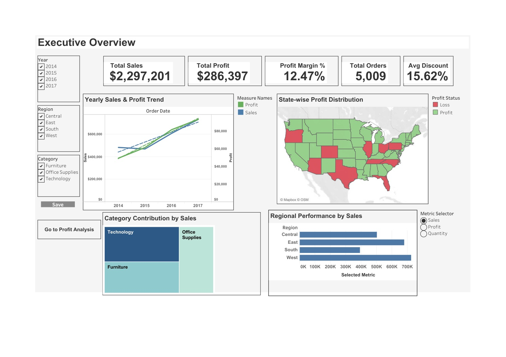
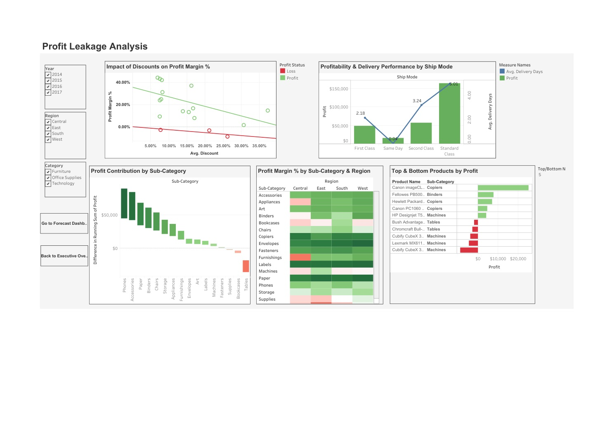
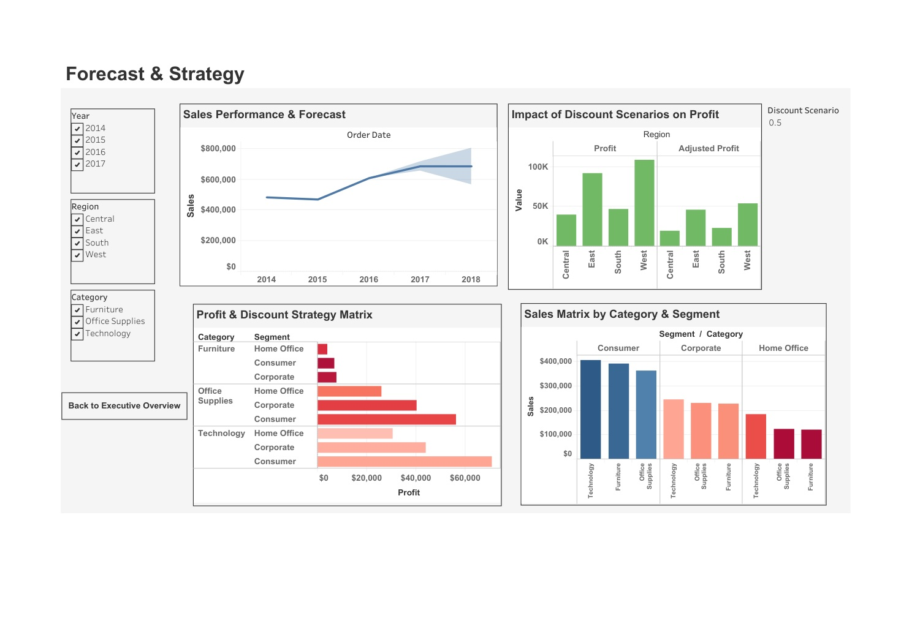

# US Superstore Sales Analysis | Tableau

## Project Overview

This project focuses on analyzing the US Superstore dataset using Tableau to understand sales performance, profitability, discount patterns, and regional trends. The analysis explores business performance from 2014 to 2017 through interactive dashboards, with additional forecasting and discount what-if scenarios to support data-driven decision-making.

## Business Objectives

- Analyze overall sales and profit performance.
- Identify profitable and loss-making products, sub-categories, and states.
- Understand the relationship between discount rates and profitability.
- Compare business performance across regions, categories, and customer segments.
- Analyze shipping performance and delivery efficiency.
- Forecast future sales and explore the impact of different discount strategies.

## Dataset Information

- **Dataset:** US Superstore
- **Records:** 9,994 order line items
- **Unique Orders:** 5,009
- **Time Period:** 2014–2017
- **Source:** [Kaggle – Superstore Dataset](https://www.kaggle.com/datasets/juhi1994/superstore)

## Tools & Technologies

- Tableau
- Data Analysis
- Exploratory Data Analysis (EDA)
- Data Visualization
- KPI Analysis
- Calculated Fields
- Parameters and Filters
- Forecasting
- What-If Analysis

## Dashboard Previews

### 1. Executive Overview

- KPI cards displaying total sales, profit, profit margin, orders, and average discount.
- Yearly sales and profit trends.
- State-wise profit distribution and regional performance.
- Category contribution analysis.
- Interactive filters and a metric selector to switch between Sales, Profit, and Quantity.

### 2. Profit Leakage Analysis

- Discount impact on profit margin.
- Profit contribution by product sub-category.
- Profit margin comparison across regions and sub-categories.
- Shipping performance analysis.
- Top and Bottom 5 products by profit using a dynamic parameter.

### 3. Forecast & Strategy

- Historical sales performance with forecasting through 2018.
- Interactive discount what-if scenarios to explore their impact on profit.
- Comparison of original and adjusted profit across regions.
- Profit and discount strategy matrix.
- Sales analysis across product categories and customer segments.

## Key Findings

- Total sales reached approximately **$2.30 million**, with a total profit of approximately **$286,397**.
- The overall profit margin was approximately **12.47%**.
- The average discount across orders was approximately **15.62%**.
- Certain states and product sub-categories recorded negative profits.
- Tables and Machines were among the loss-making sub-categories identified in the analysis.
- Higher discount levels were generally associated with lower profit margins.
- Sales and profitability varied across regions, product categories, and customer segments.

## Business Recommendations

- Review discount strategies, especially where higher discounts are associated with lower profit margins.
- Reassess pricing and cost strategies for loss-making sub-categories.
- Investigate state-wise performance to identify opportunities for improving profitability.
- Focus on products and regions that contribute positively to overall profit.
- Monitor shipping performance to identify opportunities for improving delivery efficiency.
- Use sales forecasts and discount what-if scenarios to support future business planning.

## Project Takeaway

This project helped me develop practical skills in data analysis and visualization using Tableau. It provided hands-on experience in building interactive dashboards, analyzing business KPIs, identifying profitability issues, and exploring forecasting and what-if scenarios to support business decisions.
